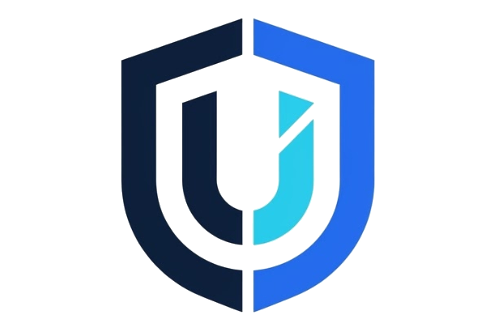
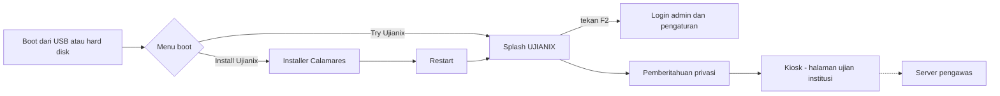
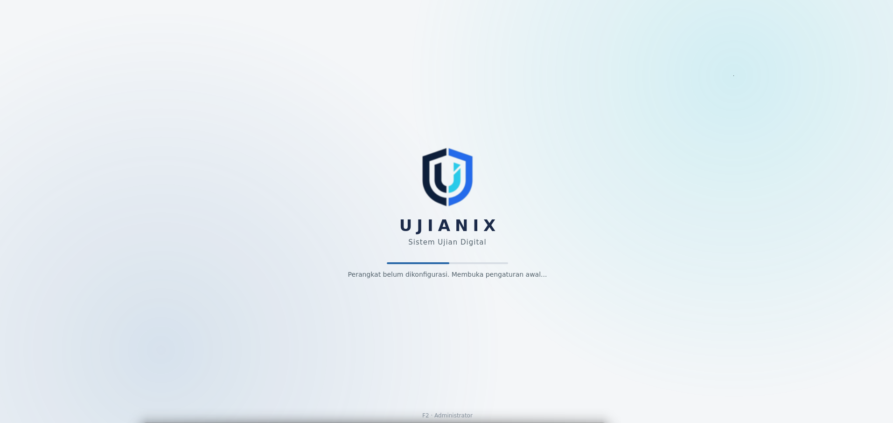
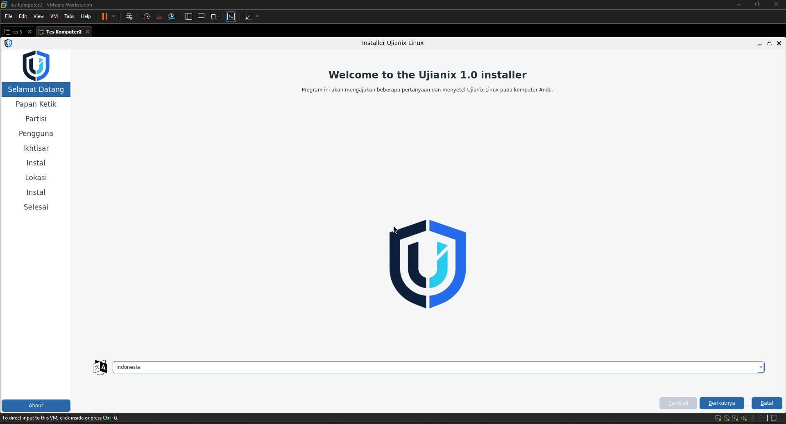

<div align="center">



# UJIANIX

Sistem operasi Linux untuk ujian berbasis Debian 13 (Trixie)

<br>

<div align="center">
    


<br>


</div>

[Instalasi](#instalasi) &middot; [Bangun ISO Sendiri](#membangun-iso-sendiri) &middot; [Server Pengawas](#server-pengawas) &middot; [Fitur](#fitur) &middot; [Anggota Kelompok](#detail-proyek)

<br>


</div>

---

## Tentang Ujianix

**Ujianix** adalah distro Linux yang dirancang khusus untuk kebutuhan ujian komputer. Saat sistem menyala, peserta langsung diarahkan ke tampilan browser layar penuh (mode kiosk) yang membuka halaman ujian sekolah atau kampus. Tidak ada tampilan desktop, tidak ada terminal, dan peserta tidak diberi akses administrator. Selama ujian berlangsung, pengawas bisa memantau aktivitas peserta lewat tangkapan layar (*screenshot*) dan foto webcam yang dikirim secara berkala ke komputer pengawas.

| No. | Keunggulan | Deskripsi |
|---|---|---|
| 1 | **Fokus pada sistem operasi** | Ujianix tidak membawa aplikasi soal ujian sendiri; web atau platform ujian (seperti Moodle, LMS lokal, atau aplikasi web kampus) tetap disediakan oleh pihak penyelenggara. |
| 2 | **Mempersempit celah kecurangan** | Sistem ini membatasi gerak-gerik peserta di dalam komputer. Meski begitu, Ujianix tentu tidak bisa mencegah kecurangan di luar layar, seperti peserta yang diam-diam memakai HP atau dibantu orang lain di sebelahnya. |
| 3 | **Tampilan bersih dan simpel** | Antarmuka dibuat minimalis agar panitia maupun peserta tidak bingung saat mengoperasikannya. |
| 4 | **Lingkungan ujian yang terkontrol** | Ujianix dirancang untuk membatasi akses peserta terhadap fitur dan aplikasi sistem operasi yang tidak diperlukan selama ujian berlangsung. |
| 5 | **Siap digunakan melalui media bootable** | Ujianix dapat dijalankan melalui USB bootable sehingga penyelenggara tidak harus memasang sistem operasi secara permanen pada komputer yang digunakan. |
| 6 | **Tidak bergantung pada instalasi aplikasi ujian tertentu** | Karena berbasis akses ke platform ujian melalui browser, Ujianix dapat digunakan bersama berbagai platform CBT berbasis web selama kompatibel. |
| 7 | **Dapat digunakan pada komputer yang sudah tersedia** | Ujianix memberikan alternatif pemanfaatan komputer atau laptop yang dimiliki sekolah maupun institusi tanpa harus menyediakan perangkat khusus untuk sistem operasi ujian. |
| 8 | **Berbasis Linux dan bersifat open source** | Ujianix dikembangkan menggunakan ekosistem Linux sehingga konfigurasi sistem dapat disesuaikan dengan kebutuhan serta pengembangannya tidak bergantung pada lisensi sistem operasi komersial. |
| 9 | **Mengurangi gangguan selama ujian** | Dengan meminimalkan fitur dan aplikasi yang tidak relevan, peserta dapat lebih fokus pada pengerjaan ujian tanpa terganggu oleh aktivitas sistem operasi lainnya. |

### Alur kerja singkat



| Pilihan boot | Kegunaan |
| --- | --- |
| **Try Ujianix** *(bawaan)* | Menjalankan Ujianix langsung dari flashdisk tanpa mengutak-atik isi hard disk komputer. Semua pengaturan akan hilang begitu komputer dimatikan. |
| **Install Ujianix** | Membuka installer Calamares untuk memasang Ujianix ke komputer. Isi hard disk baru akan dihapus atau diubah setelah Anda menyetujuinya di layar instalasi. |

---

## Fitur

| Fitur | Keterangan |
| --- | --- |
| Boot BIOS dengan menu bermerek | Menu pemilihan mode boot khusus Ujianix untuk komputer lama yang masih pakai Legacy BIOS |
| Boot UEFI (GRUB) | Mendukung proses booting di komputer atau laptop modern berbasis UEFI |
| Try Ujianix (live dari USB) | Menjalankan sistem ujian langsung lewat flashdisk tanpa perlu instal ke hard disk |
| Install Ujianix (Calamares, bahasa Indonesia) | Menginstal Ujianix secara permanen ke penyimpanan komputer lewat tampilan grafis berbahasa Indonesia |
| Kiosk Firefox ESR layar penuh | Mengunci browser ujian dalam mode layar penuh tanpa address bar, tab, atau tombol menu |
| Layar splash UJIANIX | Menampilkan logo dan animasi Ujianix saat proses booting sebelum masuk ke layar ujian |
| Halaman konfigurasi admin (HTML/CSS + Python) | Panel web lokal bagi panitia/admin untuk membuat akun, login, dan mengatur jalannya ujian |
| Mengubah konfigurasi lewat tombol F2 saat splash | Buka menu pengaturan admin cukup dengan menekan F2 saat splash screen tanpa harus mengutak-atik menu boot |
| Pengawasan: screenshot, foto webcam, kejadian USB | Mengambil tangkapan layar, foto kamera peserta, serta mencatat aktivitas colok/cabut USB untuk dikirim ke server pengawas |
| Pemberitahuan privasi sebelum pengawasan | Memunculkan layar persetujuan kepada peserta sebelum kamera dan tangkapan layar mulai merekam |
| Mode online dan offline (alamat server bebas) | Alamat server ujian bisa diatur bebas, baik untuk ujian online lewat internet maupun offline pakai server lokal (LAN) |
| Akun peserta tanpa hak administratif | Akun peserta tidak punya akses `sudo`, jadi mereka tidak bisa mengubah pengaturan atau mengutak-atik sistem |
| Firewall whitelist (default-deny) | Memblokir semua koneksi internet dan hanya membuka akses ke alamat IP atau domain yang didaftarkan panitia |
| Penutupan konsol teks dan penguncian parameter boot | Mematikan akses terminal TTY (Ctrl+Alt+F1–F6) dan mengunci parameter boot agar peserta tidak bisa masuk ke mode recovery |
| Kebijakan Firefox kiosk yang lebih ketat | Membatasi tombol pintasan (shortcut) keyboard serta menutup akses pengaturan dan ekstensi di browser |
| Secure Boot | Membuat Ujianix tetap bisa booting di perangkat yang mengaktifkan fitur keamanan UEFI Secure Boot |

---

## Tampilan

<table>
  <tr>
    <td align="center"><br><sub>Layar splash</sub></td>
    <td align="center"><br><sub>Pengaturan awal admin</sub></td>
  </tr>
  <tr>
    <td align="center"><br><sub>Installer berbahasa Indonesia</sub></td>
    <td align="center"><br><sub>Dashboard Administrator</sub></td>
  </tr>
</table>

---

## Instalasi

### Persyaratan

| Kebutuhan | Keterangan |
| --- | --- |
| Prosesor | 64-bit (x86_64 / AMD64) |
| RAM | Target minimal 1 GB (belum dibuktikan). Disarankan 2 GB atau lebih |
| Penyimpanan | Try: USB 2 GB atau lebih. Install: disk dengan ruang minimal 7 GB |
| Jaringan | Kabel Ethernet. Saat ini belum ada antarmuka untuk memilih jaringan Wi-Fi |

### 1. Unduh file ISO

1. Buka halaman **[Releases](https://github.com/iksnrizal/Ujianix/releases/tag/v.1.0)** dan unduh `ujianix-1.0-amd64.iso` beserta file `SHA256SUMS`.
2. Cek keaslian file ISO yang sudah diunduh. Kode hash yang muncul di terminal harus persis sama dengan isi `SHA256SUMS`.

   **Windows (PowerShell):**
   ```powershell
   Get-FileHash .\ujianix-1.0-amd64.iso -Algorithm SHA256
   ```

   **Linux atau macOS:**
   ```bash
   sha256sum ujianix-1.0-amd64.iso
   ```

### 2. Coba di mesin virtual (paling aman)

Kalau baru mau mencoba-coba tanpa risiko mengubah isi komputer, jalankan saja lewat mesin virtual. Tim kami menguji sistem ini menggunakan VMware Workstation dengan setelan berikut:

| Pengaturan VM | Nilai |
| --- | --- |
| Sistem operasi tamu | Linux, Debian 64-bit |
| RAM | 1024 MB |
| Hard disk | 7 GB |
| Firmware | BIOS (mode UEFI belum diuji) |
| Jaringan | **Bridged**, supaya VM terhubung satu jaringan dengan server ujian dan server pengawas |
| Boot | Masukkan file ISO Ujianix ke drive CD/DVD virtual |

### 3. Buat bootable USB (untuk komputer fisik)

> [!WARNING]
> Proses ini akan **menghapus seluruh data di dalam flashdisk**. Pastikan Anda memilih drive yang benar sebelum mulai.

- **Windows:** Pakai [Rufus](https://rufus.ie). Pilih file ISO Ujianix, lalu saat muncul jendela konfirmasi, pilih opsi **Write in DD Image mode**.
- **Windows, macOS, Linux:** Bisa juga memakai [balenaEtcher](https://etcher.balena.io) atau [Ventoy](https://www.ventoy.net).
- **Linux (lewat terminal):** Ganti `/dev/sdX` dengan alamat flashdisk Anda (cek dulu pakai perintah `lsblk`).

  ```bash
  sudo dd if=ujianix-1.0-amd64.iso of=/dev/sdX bs=4M status=progress conv=fsync
  ```

> [!NOTE]
> Sebelum dipakai untuk ujian betulan, pastikan Anda mencobanya langsung di komputer lab yang akan digunakan.

### 4. Pilih mode saat booting

Begitu komputer menyala dari flashdisk, akan muncul dua pilihan utama:

- **Try Ujianix:** Untuk menjalankan sistem sementara tanpa instal. Setelan admin akan hilang setelah komputer dimatikan.
- **Install Ujianix:** Untuk memasang Ujianix ke dalam hard disk. Setelan admin akan tersimpan permanen.

### 5. Langkah instalasi (Install Ujianix)

> [!CAUTION]
> Memilih opsi hapus disk saat instalasi akan **melenyapkan semua data lama** di hard disk tersebut. Gunakan hanya pada komputer yang memang dikhususkan untuk ruang ujian.

1. Pilih **Install Ujianix** pada menu boot. Installer akan terbuka dalam bahasa Indonesia.
2. **Selamat Datang:** Klik **Berikutnya**. Lokasi (Asia/Jakarta), bahasa, dan tata letak keyboard sudah otomatis disesuaikan untuk Indonesia.
3. **Partisi:** Pilih hard disk tujuan dan cara pembagian partisinya. Ringkasan perubahan akan ditampilkan dulu sebelum disk benar-benar diformat.
4. **Pengguna:** Isi nama lengkap, username, nama komputer, dan password. Akun yang dibuat di sini adalah akun peserta ujian dan **tidak memiliki hak administrator**.
5. **Ikhtisar:** Cek kembali semua pilihan Anda, lalu klik **Pasang** untuk memulai.
6. Tunggu sampai proses selesai, klik restart, lalu cabut flashdisk dari komputer.

### 6. Pengaturan awal admin (saat pertama kali menyala)

Setelah selesai diinstal (atau setiap kali memilih Try), layar splash UJIANIX akan muncul. Karena sistem masih kosong dan belum diatur, halaman **Pengaturan Awal** akan terbuka otomatis:

| Kolom pengaturan | Keterangan |
| --- | --- |
| Password administrator | Minimal 12 karakter. Password ini dibuat sekali saja di awal untuk mengunci akses admin |
| Mode server | Pilih **Online** (server ujian lewat internet) atau **Offline** (server lokal di jaringan ruangan) |
| Alamat server ujian | URL halaman ujian milik sekolah/kampus, contohnya `https://ujian.sekolah.sch.id` |
| Whitelist jaringan | Tulis daftar domain yang boleh dibuka (satu domain per baris). Alamat server ujian dan server pengawas otomatis masuk daftar |
| Pengawasan | Aktifkan tangkapan layar dan/atau foto webcam berkala dengan jeda 1 sampai 1440 menit |
| Alamat server pengawas | Wajib diisi jika fitur pengawasan dinyalakan. Salin alamat lengkap beserta kode unik dari [server pengawas](#server-pengawas) |
| Pemberitahuan privasi | Pesan persetujuan yang wajib dibaca peserta sebelum ujian dimulai |

Setelah klik **Simpan dan Lanjutkan**, Anda akan masuk ke dashboard admin. Klik tombol **Mulai Ujian** untuk masuk ke layar ujian peserta.

### 7. Cara mengubah pengaturan di kemudian hari

1. Restart komputer peserta.
2. Tekan tombol **F2** saat layar splash UJIANIX muncul.
3. Masukkan password administrator, lalu pilih menu **Ubah Pengaturan**. *(Catatan: formulir pengaturan perlu diisi ulang dari awal).*

---

## Server pengawas

Aplikasi server pengawas dijalankan di komputer atau laptop panitia (bisa di Windows, Linux, maupun macOS) untuk menampung kiriman tangkapan layar, foto webcam, dan log aktivitas dari komputer peserta. File skripnya tersimpan di folder [`tools/pengawas`](build/tools/pengawas).

1. Pastikan [Python 3](https://www.python.org/downloads/) sudah terpasang di komputer pengawas.
2. Jalankan file `jalankan-pengawas.bat` (khusus Windows), atau buka terminal dan ketik:
   - **Windows:** `py ujianix-pengawas.py 8000`
   - **Linux / macOS:** `python3 ujianix-pengawas.py 8000`
3. Di layar terminal akan muncul alamat server lengkap dengan **kode rahasia di bagian belakangnya**, misalnya `http://192.168.1.10:8000/AbC123xyz`. Salin alamat tersebut dan masukkan ke kolom **Alamat server pengawas** saat mengatur komputer peserta. Kode acak ini berguna supaya tidak ada perangkat iseng yang mengirim data palsu ke server.
4. Jika muncul peringatan Windows Firewall, klik **Allow** agar Python diizinkan menerima koneksi. Pastikan komputer pengawas dan peserta terhubung di jaringan yang sama.
5. Buka browser di komputer pengawas dan kunjungi `http://127.0.0.1:8000` untuk memantau jalannya ujian.

Di halaman galeri pengawas, panitia bisa melihat status peserta (**Aktif** atau **Terputus**), hasil screenshot dan foto kamera terbaru beserta riwayatnya, catatan kejadian (seperti peserta mencolokkan flashdisk, koneksi terputus, atau kamera bermasalah), serta tombol **Unduh semua (ZIP)** untuk mengarsipkan bukti ujian. Halaman ini akan menyegarkan tampilannya secara otomatis setiap 10 detik.

Semua file foto dan log disimpan di folder `data-pengawasan` yang berada tepat di sebelah skrip server.

---

## Membangun ISO sendiri

### Persiapan

| Kebutuhan | Keterangan |
| --- | --- |
| Sistem operasi | Debian 13 (Trixie) 64-bit. Kalau pakai Windows, bisa lewat WSL: `wsl --install -d Debian` |
| Lokasi folder | Simpan di direktori home Linux (misalnya `~/Ujianix`), **jangan** taruh di drive Windows (`/mnt/c`) |
| Spesifikasi mesin | Ruang kosong disk minimal 15 GB, RAM 4 GB, dan koneksi internet yang stabil |
| Estimasi waktu | Sekitar 30–60 menit untuk proses build pertama kali |

### Cara otomatis (disarankan)

Cukup jalankan satu baris perintah ini untuk mengunduh kode, memasang alat yang dibutuhkan, membangun file ISO, sekaligus membuat kode checksum-nya:

```bash
sudo apt-get update && sudo apt-get install -y git && git clone https://github.com/iksnrizal/Ujianix.git && cd Ujianix && sudo bash "$(find . -maxdepth 3 -name build-ujianix.sh | head -1)"
```

File ISO yang sudah jadi beserta `SHA256SUMS` dan daftar paketnya akan tersimpan otomatis di dalam folder `build/hasil/`.

### Cara manual

Jika ingin menjalankannya langkah demi langkah, pastikan terminal tidak ditutup di tengah jalan (terutama dari langkah 3 sampai 6).

<details>
<summary><b>Lihat panduan build manual</b></summary>

**1. Pasang paket pendukung**
```bash
sudo apt-get update && sudo apt-get install -y live-build debootstrap squashfs-tools xorriso isolinux syslinux syslinux-common syslinux-utils grub-pc-bin grub-efi-amd64-bin grub-common mtools dosfstools cpio rsync git ca-certificates debian-archive-keyring
```

**2. Unduh kode sumber**
```bash
cd ~ && git clone https://github.com/iksnrizal/Ujianix.git
```

**3. Masuk ke direktori build** *(pastikan folder `config` terlihat saat dicek)*
```bash
cd "$(dirname "$(dirname "$(find ~/Ujianix -path '*/config/common' -not -path '*/chroot/*' | head -1)")")" && pwd && ls
```

**4. Atur hak akses file**
```bash
sudo mkdir -p config/includes.chroot_after_packages/etc/ujianix && sudo chown -R root:root config && sudo chmod 440 config/includes.chroot_after_packages/etc/sudoers.d/ujianix-installer && sudo chmod 755 config/includes.chroot_after_packages/usr/local/bin/* config/includes.chroot_after_packages/usr/local/sbin/* config/hooks/live/* && sudo mkdir -p .build && sudo touch .build/config && echo SIAP
```

**5. Mulai bangun ISO**
```bash
sudo lb build 2>&1 | tee build-manual.log
```

**6. Cek hasil file ISO**
```bash
ls -lh *.iso && sha256sum *.iso
```

**Kalau ingin membangun ulang setelah mengedit kode:**
```bash
sudo lb clean && sudo mkdir -p .build && sudo touch .build/config && sudo lb build 2>&1 | tee build-manual.log
```

Setelah selesai build manual, kembalikan kepemilikan folder `config` ke user biasa agar perintah Git tidak error: `sudo chown -R $USER:$USER config`.

</details>

> [!IMPORTANT]
> **Jangan pernah menjalankan perintah `lb config`.** Perintah tersebut akan mereset semua pengaturan build kembali ke bawaan Debian dan menghapus seluruh konfigurasi Ujianix.

### Kendala yang sering ditemui saat build

<details>
<summary><b>Lihat daftar masalah dan solusinya</b></summary>

| Masalah yang muncul | Penyebab & cara mengatasinya |
| --- | --- |
| `required to be done first: config` | File penanda tahap build hilang setelah menjalankan `lb clean`. Jalankan `mkdir -p .build && touch .build/config`, atau pakai skrip otomatis saja |
| Mode Try menampilkan pesan *"Tidak dapat tersambung ke 127.0.0.1:8765"* | Folder `/etc/ujianix` tidak ikut masuk ke ISO karena Git tidak menyimpan folder kosong. Gunakan skrip otomatis agar folder tersebut dibuatkan |
| Calamares gagal terbuka atau akses `sudo` ditolak | Kepemilikan atau izin file berubah. Saat build, seluruh isi `config/` harus dimiliki `root:root` dan file `sudoers.d/ujianix-installer` wajib berizin `440` |
| Build berhenti karena konflik `includes.chroot` dan `includes.chroot_after_packages` | Hanya salah satu folder yang boleh berisi file. Ujianix menggunakan `includes.chroot_after_packages` |
| Skrip menolak berjalan di folder `/mnt/c` | Pindahkan folder repositori ke dalam direktori home Linux (`~`) |
| Gagal mengunduh paket di tengah jalan | Cek koneksi internet Anda lalu ulangi perintah build. Paket yang sudah terunduh tersimpan di cache sehingga proses ulang akan jauh lebih cepat |

</details>

---

## Arsitektur sistem

| Bagian | Peran |
| --- | --- |
| **Sistem operasi Ujianix** | Berbasis Debian 13 yang menjalankan sesi kiosk (Cage + Firefox ESR), layanan latar belakang systemd, panel pengaturan lokal, serta installer Calamares |
| **Server ujian** | Disediakan oleh sekolah/kampus (bisa berupa server web online maupun server lokal di jaringan ruangan) |
| **Server pengawas** | Aplikasi penerima screenshot, foto webcam, dan log dari peserta. Bisa dijalankan di komputer yang sama dengan server ujian atau dipisah |

### Susunan folder repositori

```text
Ujianix/
├── README.md
├── docs/img/                         gambar pendukung dokumentasi
└── build/
    ├── build-ujianix.sh              skrip build otomatis
    ├── BUILD.md                      catatan singkat cara build
    ├── config/                       konfigurasi live-build (JANGAN dihapus)
    │   ├── common, bootstrap, chroot, binary, source
    │   ├── package-lists/            daftar paket yang diinstal ke ISO
    │   ├── hooks/live/               skrip pengaturan bahasa, zona waktu, & menu GRUB
    │   ├── bootloaders/              tampilan menu boot (syslinux dan GRUB)
    │   └── includes.chroot_after_packages/   seluruh file sistem Ujianix
    │       ├── etc/                  layanan systemd, sudoers, Calamares, GRUB, skel
    │       └── usr/                  server pengaturan lokal, agen pengawas, & antarmuka web
    └── tools/pengawas/               aplikasi server untuk komputer pengawas
```

### File konfigurasi utama

Seluruh setelan yang disimpan lewat halaman admin ditulis ke file `/etc/ujianix/ujianix.conf` (hanya bisa dibaca/ubah oleh root):

| Nama variabel | Fungsi |
| --- | --- |
| `UJIANIX_SERVER_MODE` | Mode jaringan ujian (`online` atau `offline`) |
| `UJIANIX_SERVER_URL` | Alamat web server ujian |
| `UJIANIX_WHITELIST` | Daftar alamat domain yang diizinkan diakses (dipisah dengan koma) |
| `UJIANIX_SCREENSHOT_ENABLED` / `UJIANIX_SCREENSHOT_INTERVAL` | Status aktif tangkapan layar dan jeda waktunya (dalam menit) |
| `UJIANIX_WEBCAM_ENABLED` | Status aktif pengambilan foto webcam |
| `UJIANIX_PRIVACY_NOTICE` | Teks pemberitahuan privasi yang tampil sebelum ujian mulai |
| `UJIANIX_SUPERVISOR_URL` | Alamat server pengawas (wajib diisi kalau fitur pengawasan aktif) |

---

## Privasi dan pengelolaan data

- Peserta akan melihat pemberitahuan yang jelas dan harus menekan tombol **Saya mengerti** sebelum kamera atau tangkapan layar mulai bekerja.
- Hasil tangkapan layar dan foto webcam langsung dikirim ke server pengawas dan **tidak pernah disimpan ke dalam hard disk komputer peserta**. Jika koneksi ke server pengawas terputus sebentar, data ditahan sementara di memori RAM lalu dikirim ulang begitu jaringan pulih.
- Pihak sekolah atau institusi penyelenggara ujian bertanggung jawab penuh atas keamanan penyimpanan, hak akses, dan penghapusan data rekaman pengawasan setelah ujian selesai.

---
## Detail Proyek

Proyek ini dikembangkan oleh kelompok 10.

<div align="center">
<table>
<tr>
<td valign="top">

### Anggota Kelompok

| Nama | NPM |
|---|---|
| Muhammad Mufti Faried | 257006111070 |
| Fasha Octa Ramdani | 257006111076 |
| Muhammad Ikhsan Alrizal | 257006111086 |
| Agnia Agustin Ramadhani | 257006111090 |
| Azizah Dwi Suryaningtyas | 257006111092 |
| Nazwa Nurul Aulia | 257006111094 |

</td>
<td valign="top">

### Identitas Akademik

| Informasi | Keterangan |
|---|---|
| **Mata Kuliah** | Sistem Operasi |
| **Program Studi** | Informatika |
| **Fakultas** | Teknik |
| **Universitas** | Universitas Siliwangi |
| **Tahun Akademik** | Ganjil 2026/2027 |
| **Dosen Pengampu** | Muhammad Sidik Asyaky, S.T., M.T. |

</td>
</tr>
</table>
</div>

## Lisensi dan perangkat lunak terbuka

Proyek Ujianix direncanakan rilis di bawah lisensi **GPL** (versi pastinya sedang difinalisasi tim dan akan dicantumkan di file `LICENSE`). Sistem ini dibangun dengan memadukan berbagai perangkat lunak sumber terbuka berikut (detail lisensi tiap paket bisa dicek langsung di `/usr/share/doc/<nama-paket>/copyright` di dalam sistem):

| Komponen | Fungsi | Lisensi |
| --- | --- | --- |
| Debian GNU/Linux 13 | Sistem operasi dasar | Beragam (DFSG) |
| live-build | Alat pembuat file ISO | GPL-3.0 atau lebih baru |
| Calamares | Installer sistem | GPL-3.0 atau lebih baru |
| Cage dan wlroots | Kompositor layar penuh (kiosk) | MIT |
| Firefox ESR | Browser utama peserta ujian | MPL-2.0 |
| GRUB dan SYSLINUX | Menu boot untuk UEFI dan BIOS | GPL |
| grim | Pengambil tangkapan layar di Wayland | MIT |
| fswebcam | Pengambil foto dari webcam | GPL |
| systemd dan NetworkManager | Pengelola layanan latar belakang & jaringan | LGPL / GPL |
| Python | Backend konfigurasi lokal, agen pengawas, dan server galeri | PSF |

---

<div align="center">


**UJIANIX** &middot; Sistem Ujian Digital

</div>
