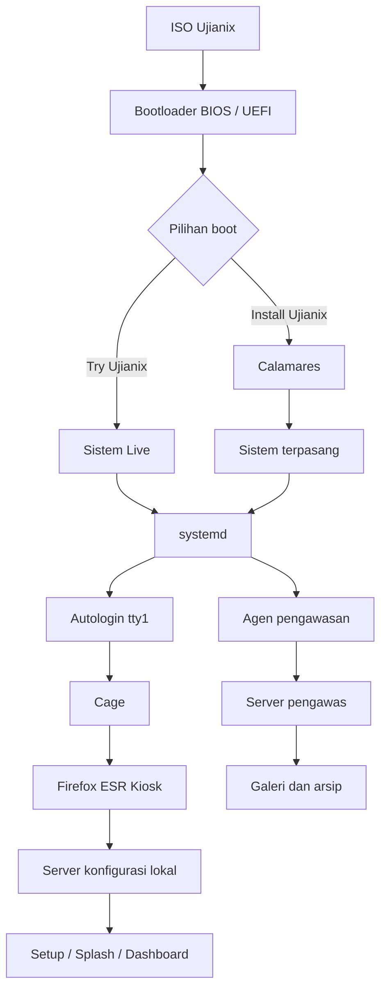

# Dokumentasi Arsitektur dan Implementasi Teknis Ujianix

**Nama proyek:** UJIANIX  
**Basis:** Debian 13 (Trixie), AMD64  
**Tanggal:** 23 November 2026  
**Status:** Dokumentasi teknis berdasarkan konteks proyek dan progres terakhir.

## 1. Pendahuluan

Ujianix adalah distribusi Linux khusus ujian. Sistem menyediakan lingkungan browser kiosk, konfigurasi lokal, installer, serta dukungan pengawasan visual opsional. Ujianix hanya menyediakan sistem operasi dan lingkungan pelaksanaan; aplikasi atau situs ujian tetap disediakan institusi. Sistem membantu mempersulit dan mendeteksi tindakan yang tidak sesuai, tetapi tidak menjamin kecurangan mustahil dilakukan.

## 2. Gambaran Arsitektur

Ujianix terdiri dari beberapa lapisan:
1. Sistem operasi Debian 13 AMD64.
2. Sistem build ISO menggunakan live-build.
3. Bootloader untuk BIOS dan UEFI.
4. Lingkungan kiosk menggunakan Cage/Wayland dan Firefox ESR.
5. Backend konfigurasi lokal berbasis Python.
6. Installer Calamares.
7. Agen pengawasan pada perangkat peserta dan server pengawas terpisah.

### 2.1 Diagram komponen



## 3. Teknologi Utama

| Komponen | Teknologi | Fungsi |
|---|---|---|
| Sistem operasi | Debian 13 (Trixie) AMD64 | Basis distribusi |
| Pembuatan ISO | live-build | Menyusun image dan ISO |
| Pengelola layanan | systemd | Menjalankan layanan saat boot |
| Lingkungan kiosk | Cage / Wayland | Menjalankan antarmuka layar penuh |
| Browser | Firefox ESR | Menampilkan antarmuka dan situs ujian |
| Backend | Python 3 standard library | Server HTTP lokal dan validasi konfigurasi |
| Antarmuka | HTML/CSS | Halaman setup, dashboard, splash |
| Installer | Calamares | Instalasi ke perangkat |
| Screenshot | grim | Mengambil layar Wayland |
| Webcam | fswebcam | Mengambil gambar kamera |
| Server pengawas | Python | Menerima data dan menampilkan galeri |

## 4. Struktur Proyek

Direktori kerja utama tercatat `~/Ujianik/build`, sedangkan clone GitHub berada di `~/SO/Ujianik`.

```text
build/
├── config/
│   ├── package-lists/
│   │   └── ujianix.list.chroot
│   ├── hooks/
│   │   └── live/
│   ├── bootloaders/
│   │   ├── syslinux_common/
│   │   └── grub-pc/
│   └── includes.chroot_after_packages/
└── tools/
    └── pengawas/
        ├── ujianix-pengawas.py
        └── jalankan-pengawas.bat
```

- `package-lists/`: daftar paket yang dipasang.
- `hooks/live/`: skrip penyesuaian selama proses build.
- `bootloaders/`: konfigurasi bootloader dan aset menu.
- `includes.chroot_after_packages/`: file yang dimasukkan ke filesystem image.
- `tools/pengawas/`: server pengawas untuk komputer pengawas.

Konfigurasi live-build yang sudah terbentuk perlu dipertahankan. Catatan proyek secara khusus menghindari menjalankan `lb config` karena dapat mengembalikan konfigurasi ke nilai bawaan.

## 5. Sistem Boot

Menu boot menyediakan dua pilihan utama:
- **Try Ujianix:** menjalankan sistem live tanpa memasang sistem ke penyimpanan.
- **Install Ujianix:** menjalankan installer Calamares.

Try Ujianix menjadi pilihan default. Mode installer dipicu parameter boot `ujianix.install=1`. Rancangan menu tidak menyediakan pilihan ketiga untuk mode admin.

### 5.1 Alur Try Ujianix

1. Perangkat boot dari ISO/media Ujianix.
2. Bootloader memulai sistem live.
3. systemd menjalankan layanan Ujianix.
4. Sistem melakukan autologin pada `tty1`.
5. Cage menjalankan Firefox ESR dalam mode kiosk.
6. Firefox membuka halaman splash pada server lokal.
7. Jika konfigurasi belum tersedia, alur setup ditampilkan.
8. Jika konfigurasi tersedia, halaman splash melanjutkan alur sesuai konfigurasi, termasuk pemberitahuan privasi jika pengawasan aktif.

Sistem live tidak menggunakan persistence; perubahan pada sesi live tidak dirancang untuk bertahan setelah perangkat dimatikan.

### 5.2 Alur Install Ujianix

1. Pengguna memilih Install Ujianix.
2. Parameter `ujianix.install=1` dikenali.
3. Skrip `ujianix-installer` menjalankan Calamares melalui Cage.
4. Calamares menjalankan proses instalasi.
5. Halaman Lokasi dan Papan Ketik tidak ditampilkan karena pengaturan locale, zona waktu, dan keyboard ditanam pada image.
6. Setelah instalasi, sistem terpasang menjalankan layanan Ujianix saat boot.

Akun peserta dirancang agar tidak menjadi anggota grup `sudo`.

## 6. Lingkungan Kiosk dan Konfigurasi

### 6.1 Cage dan Firefox ESR

Cage digunakan sebagai lingkungan Wayland minimal untuk menjalankan Firefox ESR dalam mode kiosk. Perintah peluncuran yang tercatat:

```bash
cage -- firefox-esr --kiosk http://127.0.0.1:8765/splash
```

### 6.2 Server konfigurasi lokal

`ujianix-config-server` merupakan server HTTP Python yang mendengarkan pada `127.0.0.1:8765`.

| Rute | Fungsi |
|---|---|
| `/setup` | Pendaftaran admin pertama dan pengaturan awal |
| `/login` | Login admin |
| `/dashboard` | Pengelolaan konfigurasi |
| `/save` | Menyimpan konfigurasi |
| `/splash` | Halaman awal Ujianix |
| `/start` | Melanjutkan ke alamat ujian |
| `/ack` | Mencatat persetujuan pemberitahuan privasi |
| `/launch` | Melanjutkan alur peluncuran |

Mekanisme yang tercatat meliputi sesi cookie 15 menit, perlindungan CSRF, dan pembatasan akses ke loopback. Pendaftaran admin pertama menggunakan kata sandi minimal 12 karakter dan PBKDF2-SHA256.

### 6.3 Backend konfigurasi

`ujianix-load-config` memvalidasi konfigurasi dan menyiapkan informasi runtime seperti `/run/ujianix/server-url` serta status konfigurasi.

Berkas konfigurasi utama:

```text
/etc/ujianix/ujianix.conf
```

Kunci yang tercatat:

| Kunci | Keterangan |
|---|---|
| `UJIANIX_SERVER_MODE` | Mode `online` atau `offline` |
| `UJIANIX_SERVER_URL` | Alamat aplikasi/situs ujian |
| `UJIANIX_WHITELIST` | Daftar host yang diizinkan |
| `UJIANIX_SCREENSHOT_ENABLED` | Mengaktifkan screenshot |
| `UJIANIX_SCREENSHOT_INTERVAL` | Interval screenshot dalam menit |
| `UJIANIX_WEBCAM_ENABLED` | Mengaktifkan webcam |
| `UJIANIX_PRIVACY_NOTICE` | Pengaturan pemberitahuan privasi |
| `UJIANIX_SUPERVISOR_URL` | Alamat server pengawas |

Keberadaan kunci whitelist tidak membuktikan firewall default-deny telah diterapkan. Implementasi dan pengujian firewall masih tercatat sebagai pekerjaan pengamanan.

## 7. Installer Calamares

Konfigurasi installer berada di `/etc/calamares/`, termasuk `settings.conf`, konfigurasi modul, dan direktori branding `branding/ujianix/`.

Alur halaman yang dirancang mencakup Welcome, Partition, Users, Summary, dan Finished. Pengaturan lokasi, locale, zona waktu, dan keyboard dilakukan pada image sehingga halaman Lokasi dan Papan Ketik tidak ditampilkan. Skrip `ujianix-installer` menjalankan Calamares melalui Cage dengan locale Indonesia dan platform Wayland.

## 8. Pengawasan Peserta

Pengawasan menggunakan dua komponen terpisah:
1. Agen pengawasan pada perangkat peserta.
2. Server pengawas pada komputer pengawas.

Pengambilan data baru dimulai setelah peserta menyetujui pemberitahuan privasi melalui tombol **Saya mengerti**. Agen menunggu penanda persetujuan di `/run/ujianix/ack`.

### 8.1 Agen pengawasan

Agen berada pada:

```text
/usr/local/sbin/ujianix-supervisor-agent
```

Agen dikelola oleh `ujianix-supervisor.service`. Komponen yang digunakan adalah `grim` untuk screenshot, `fswebcam` untuk kamera, dan Python standard library untuk pengiriman data.

Jenis data yang dirancang dikirim meliputi screenshot, foto webcam, ping/heartbeat, dan kejadian seperti pengawasan dimulai, kegagalan pengambilan gambar, pemulihan koneksi, serta perubahan perangkat USB.

### 8.2 Server pengawas

Server berada pada:

```text
tools/pengawas/ujianix-pengawas.py
```

Server dijalankan pada komputer pengawas menggunakan Python di Windows:

```powershell
py ujianix-pengawas.py 8000
```

Server menyediakan halaman galeri yang menampilkan perangkat peserta, status aktif/terputus, jumlah gambar, kejadian, dan unduhan ZIP. Catatan pengujian proyek menggunakan jaringan VMware mode **Bridged** agar VM dapat menjangkau komputer pengawas. Kamera harus diteruskan ke VM jika pengujian dilakukan di mesin virtual.

### 8.3 Status finalisasi pengawasan

Progres terakhir menyebutkan pengawasan masih berupa prototipe dan menjadi pekerjaan utama yang tersisa. Rancangan pembaruan build berikutnya mencakup:
- menghapus `ProtectHome=true` agar agen dapat mengakses soket Wayland;
- melaporkan penyebab kegagalan screenshot/kamera ke galeri;
- antrean pengiriman sementara di memori dan pengiriman ulang saat koneksi pulih;
- pencatatan koneksi pulih dan kejadian USB;
- heartbeat setelah persetujuan privasi;
- status Aktif/Terputus per perangkat;
- unduhan ZIP;
- kode akses untuk endpoint upload;
- pembersihan penanda debug `UJIANIX-DEBUG`.

**Catatan status:** poin-poin tersebut merupakan rancangan perubahan build ke-8 yang tercantum pada progres. Dokumen ini tidak menyatakan bahwa perubahan tersebut sudah diterapkan atau lulus pengujian pada ISO. Pengujian nyata di VM tetap diperlukan, terutama untuk memastikan `grim` mengambil layar Cage dan kamera benar-benar terdeteksi.

## 9. Layanan systemd

Layanan utama yang tercatat:

| Layanan | Tanggung jawab |
|---|---|
| `ujianix-config.service` | Pemuatan/validasi konfigurasi |
| `ujianix-config-server.service` | Server konfigurasi lokal |
| `ujianix-supervisor.service` | Agen pengawasan |

Layanan diaktifkan melalui symlink pada:

```text
/etc/systemd/system/multi-user.target.wants/
```

Untuk memeriksa symlink, gunakan `ls -l`. Pemeriksaan `-e` dari host dapat menyesatkan untuk target symlink absolut yang tidak tersedia pada root filesystem host.

## 10. Identitas Visual

Tema Ujianix menggunakan tampilan terang dengan palet:

| Elemen | Warna |
|---|---|
| Navy | `#1B2A49` |
| Biru | `#2867A8` |
| Cyan | `#26C6DA` |
| Latar | `#F4F6F8` |
| Garis | `#D8DEE5` |
| Teks utama | `#263238` |
| Teks sekunder | `#52616B` |

Logo resmi berada di `/usr/share/ujianix/logo.png`. Logo tidak boleh diganti atau diubah proporsinya tanpa keputusan desain.

## 11. Status Implementasi Terakhir

### 11.1 Fitur ISO v7 yang telah dinyatakan sesuai kriteria oleh pengguna

- Boot menu rapi dan simetris.
- Try Ujianix berjalan sesuai kriteria.
- Mode Install dan installer sesuai kriteria.
- Sistem setelah dipasang sesuai kriteria.
- Menu Escape/F2 sesuai kriteria.
- Splash screen sesuai kriteria.

### 11.2 Fokus pekerjaan yang masih tersisa

- Finalisasi agen dan server pengawasan.
- Membuktikan screenshot dan webcam benar-benar terkirim.
- Menguji antrean dan pengiriman ulang ketika koneksi terputus.
- Menguji kode akses server pengawas.
- Menguji pencatatan kejadian USB dan status perangkat.
- Membersihkan konfigurasi debug sebelum rilis.
- Mengulang pengujian end-to-end pada ISO hasil build final.

### 11.3 Fitur yang tidak boleh diklaim selesai tanpa bukti

- Firewall whitelist/default-deny.
- Penutupan konsol teks dan penguncian parameter boot.
- Kebijakan Firefox terhadap tab baru, developer tools, dan akses file.
- Pembatasan USB.
- Penguncian akun root dan verifikasi hak akun peserta.
- Boot UEFI.
- Benchmark waktu boot dan penggunaan RAM/CPU.

## 12. Batasan dan Pertimbangan Keamanan

1. Ujianix hanya menyediakan OS dan lingkungan kiosk; aplikasi ujian disediakan institusi.
2. Pengawasan bersifat opsional dan mengikuti alur pemberitahuan serta persetujuan peserta.
3. Pengiriman data bergantung pada koneksi dan konfigurasi alamat server pengawas.
4. Pengujian di lingkungan pengembangan tidak otomatis membuktikan perilaku pada VM atau perangkat fisik.
5. Pengamanan jaringan harus dibuktikan dengan pengujian khusus, bukan hanya dari keberadaan konfigurasi.
6. Penyelenggara perlu menetapkan kebijakan penggunaan, penyimpanan, akses, dan penghapusan data pengawasan.

## 13. Referensi File Implementasi

| File/direktori | Keterangan |
|---|---|
| `config/package-lists/ujianix.list.chroot` | Daftar paket |
| `config/hooks/live/` | Hook live-build |
| `config/bootloaders/` | Konfigurasi bootloader |
| `config/includes.chroot_after_packages/usr/local/sbin/ujianix-config-server` | Server konfigurasi |
| `config/includes.chroot_after_packages/usr/local/sbin/ujianix-load-config` | Validator konfigurasi |
| `config/includes.chroot_after_packages/usr/local/sbin/ujianix-supervisor-agent` | Agen pengawasan |
| `config/includes.chroot_after_packages/usr/local/sbin/ujianix-boot-mode` | Pemeriksa mode boot |
| `config/includes.chroot_after_packages/usr/local/bin/ujianix-installer` | Peluncur installer |
| `config/includes.chroot_after_packages/etc/systemd/system/` | Unit systemd |
| `config/includes.chroot_after_packages/etc/calamares/` | Konfigurasi Calamares |
| `config/includes.chroot_after_packages/usr/share/ujianix/` | Halaman dan aset lokal |
| `tools/pengawas/ujianix-pengawas.py` | Server pengawas |

Path dan nama file di atas dirangkum dari struktur proyek yang tercatat. Cocokkan dengan repositori terbaru saat memperbarui dokumen.

## 14. Kesimpulan

Ujianix menggunakan Debian 13 sebagai fondasi, live-build untuk menghasilkan ISO, systemd untuk layanan, Cage dan Firefox ESR untuk lingkungan kiosk, Calamares untuk instalasi, serta layanan Python lokal untuk konfigurasi. Pengawasan dirancang sebagai layanan terpisah yang mengirim data dari agen peserta ke server pengawas.

Berdasarkan progres terakhir, fungsi utama Try, Install, splash, dan menu F2 pada ISO v7 telah dinyatakan sesuai kriteria oleh pengguna. Fokus penyelesaian selanjutnya adalah memfinalkan pengawasan dan membuktikan alur pengiriman data pada ISO hasil build final. Fitur yang belum diuji atau diterapkan harus tetap dicatat sebagai pekerjaan terbuka sampai tersedia bukti.

## Riwayat Perubahan

| Versi | Tanggal | Perubahan |
|---|---|---|
| 1.0 | 23 November 2026 | Penyusunan awal dokumentasi arsitektur dan implementasi teknis |
