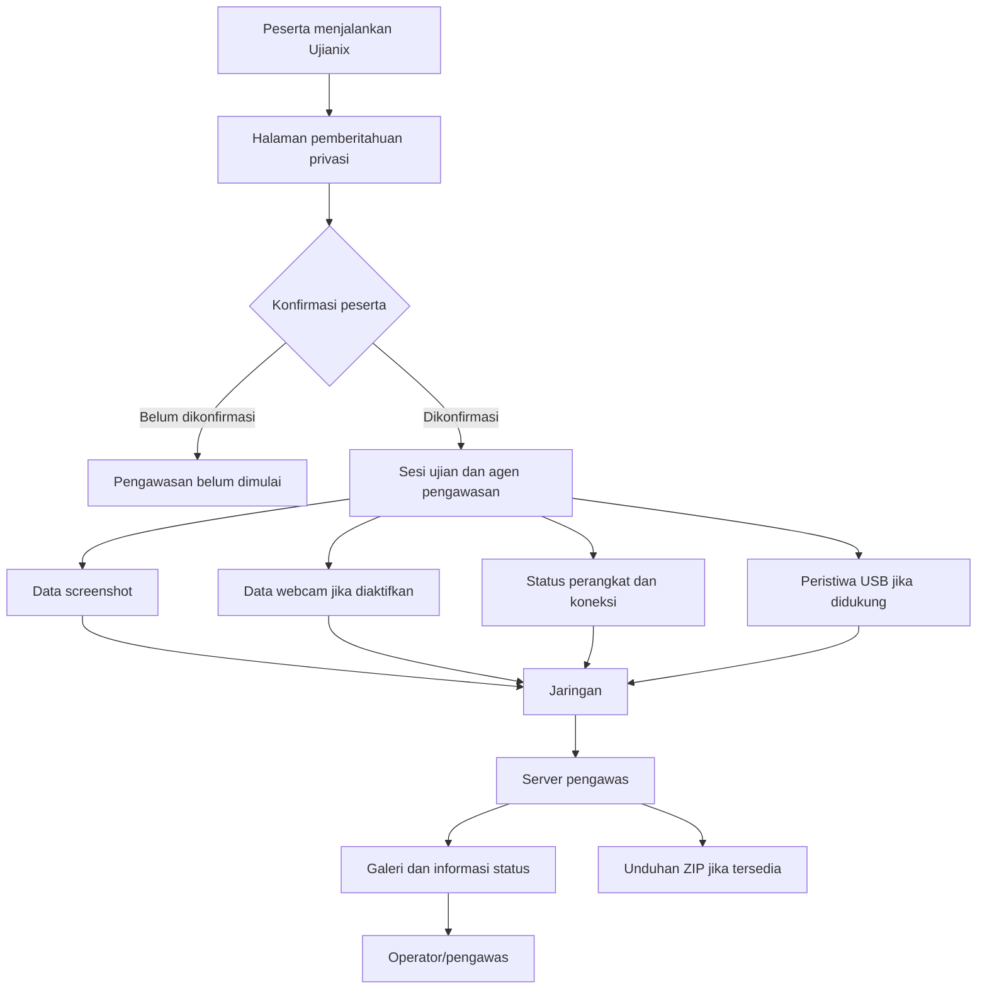

# Dokumentasi Sistem Pengawasan Peserta Ujianix

> **Status dokumen:** Draf berdasarkan konteks dan progres proyek yang tersedia. Dokumen ini belum merupakan audit kode agen dan server pengawas. Detail endpoint, format payload, nama service, lokasi konfigurasi, protokol komunikasi, dan mekanisme penyimpanan harus dicocokkan dengan implementasi pada repositori sebelum dinyatakan final.

## 1. Tujuan

Sistem pengawasan peserta merupakan komponen pendukung Ujianix untuk membantu operator memantau kondisi perangkat peserta selama sesi ujian. Prototipe yang tercatat mencakup agen pada sisi Ujianix dan aplikasi server pengawas.

Fitur yang menjadi cakupan dokumentasi ini meliputi:

- Alur pemberitahuan dan persetujuan privasi peserta.
- Pengiriman screenshot.
- Penggunaan webcam dan pengiriman gambar webcam.
- Informasi status perangkat aktif atau terputus.
- Pencatatan kejadian USB.
- Penanganan koneksi terputus dan tersambung kembali.
- Galeri bukti pengawasan dan unduhan ZIP pada aplikasi server.
- Pengujian integrasi agen dan server.

Ketersediaan setiap fitur harus diverifikasi pada build Ujianix dan versi server yang benar-benar digunakan.

## 2. Gambaran arsitektur

Secara konseptual, sistem terdiri dari tiga pihak:

1. **Perangkat peserta (Ujianix):** menjalankan sesi ujian dan agen pengawasan.
2. **Jaringan komunikasi:** menghubungkan agen pada perangkat peserta dengan server pengawas.
3. **Server pengawas:** menerima dan menyajikan data pengawasan kepada operator.



Diagram tersebut menunjukkan hubungan fungsional berdasarkan cakupan fitur proyek. Diagram ini tidak menyatakan protokol, endpoint, format data, atau urutan internal yang belum diverifikasi dari kode.

## 3. Komponen sistem

### 3.1 Agen pengawasan pada Ujianix

Agen pengawasan berjalan pada sisi perangkat peserta. Berdasarkan progres proyek, cakupan fungsinya berkaitan dengan pengiriman data pengawasan ke server, yaitu:

- Mengirim screenshot sesuai konfigurasi interval.
- Mengirim gambar webcam apabila fitur webcam diaktifkan.
- Menyampaikan informasi status perangkat atau sesi.
- Mendukung pencatatan kejadian USB sesuai implementasi.
- Menangani kondisi koneksi terputus dan tersambung kembali.

Nama proses, nama unit systemd, lokasi berkas agen, metode pengambilan screenshot, metode akses webcam, serta format pesan belum dicantumkan di sini karena perlu diverifikasi langsung pada kode sumber.

### 3.2 Server pengawas

Server pengawas menerima data dari agen dan menyediakan antarmuka bagi operator. Fitur yang tercatat dalam skenario pengujian prototipe meliputi:

- Galeri screenshot dan webcam.
- Indikator peserta/perangkat aktif.
- Informasi peristiwa USB.
- Informasi koneksi ulang.
- Unduhan berkas ZIP.

Nama route/API, struktur direktori penyimpanan, format metadata, autentikasi operator, dan mekanisme penghapusan data harus didokumentasikan setelah pemeriksaan kode server.

### 3.3 Jaringan

Agen dan server harus dapat saling berkomunikasi melalui jaringan. Pada skenario pengujian mesin virtual yang tercatat, mode jaringan **Bridged** digunakan agar mesin Ujianix dan server Windows berada pada jaringan yang dapat saling dijangkau.

Server pengawas pada skenario Windows dijalankan menggunakan perintah:

```powershell
py ujianix-pengawas.py 8000
```

Perintah ini merupakan perintah yang tercatat dalam konteks pengujian proyek. Pastikan nama skrip, dependensi, port, dan konfigurasi alamat server sesuai dengan versi aktual.

## 4. Alur privasi peserta

Progres proyek mencatat adanya halaman pemberitahuan privasi dan alur konfirmasi peserta. Pengawasan dimulai setelah peserta melewati tahap konfirmasi tersebut apabila fitur pengawasan diaktifkan.

Alur konseptual:

1. Peserta membuka alur mulai ujian.
2. Sistem menampilkan pemberitahuan privasi jika pengawasan diaktifkan.
3. Peserta membaca informasi yang disediakan.
4. Peserta memberikan konfirmasi melalui alur aplikasi.
5. Setelah konfirmasi, komponen pengawasan dapat memulai proses sesuai konfigurasi.
6. Data pengawasan dikirim ke server apabila koneksi dan layanan tersedia.

Hal-hal yang perlu dicocokkan dengan implementasi dan kebijakan penyelenggara:

- Isi lengkap pemberitahuan privasi.
- Informasi jenis data yang dikumpulkan.
- Tujuan dan dasar penggunaan data.
- Durasi penyimpanan.
- Pihak yang dapat mengakses data.
- Cara mengakhiri sesi dan menghentikan pengumpulan data.
- Penanganan jika peserta tidak dapat atau tidak menyetujui konfirmasi.

Dokumen ini tidak menetapkan kebijakan hukum atau retensi data. Penyelenggara harus menetapkan kebijakan tersebut secara terpisah dan menyampaikannya kepada peserta.

## 5. Jenis data dan informasi pengawasan

| Jenis data/informasi | Keterangan berdasarkan progres | Hal yang perlu diverifikasi |
|---|---|---|
| Screenshot | Pengiriman screenshot termasuk cakupan prototipe | Format, interval aktual, resolusi, ukuran, penamaan, dan lokasi penyimpanan |
| Gambar webcam | Pengiriman gambar webcam termasuk cakupan prototipe | Cara pengambilan, frekuensi, format, indikator kamera, dan kondisi saat kamera tidak tersedia |
| Status aktif | Server memiliki indikator peserta/perangkat aktif | Definisi aktif, interval heartbeat, dan batas waktu dianggap terputus |
| Koneksi ulang | Peristiwa reconnect termasuk skenario pengujian | Cara mendeteksi, pemulihan sesi, dan pencatatan durasi gangguan |
| Peristiwa USB | Pencatatan kejadian USB termasuk cakupan yang direncanakan/diuji | Jenis peristiwa yang dicatat dan apakah sudah tersedia pada build final |
| Arsip ZIP | Unduhan ZIP termasuk cakupan pengujian server | Isi arsip, penamaan, otorisasi unduhan, dan masa penyimpanan |

Jangan menganggap semua informasi di atas sudah tersedia atau lengkap pada setiap build. Kolom verifikasi harus diisi berdasarkan pengujian dan pemeriksaan kode.

## 6. Alur komunikasi agen dan server

Alur komunikasi tingkat tinggi yang perlu diverifikasi:

1. Operator menjalankan server pengawas.
2. Perangkat Ujianix dikonfigurasi dengan alamat server yang sesuai.
3. Peserta memulai ujian dan menyelesaikan tahap pemberitahuan privasi apabila pengawasan diaktifkan.
4. Agen pengawasan berjalan sesuai konfigurasi.
5. Agen mengirim jenis data yang diaktifkan ke server.
6. Server menerima dan menampilkan data atau status yang didukung.
7. Jika koneksi terputus, perilaku agen dan server mengikuti mekanisme pemulihan yang tersedia.
8. Setelah koneksi pulih, sistem menangani pengiriman berikutnya sesuai implementasi.

**Belum didokumentasikan:** protokol transport, endpoint, metode autentikasi, skema payload, kode status, mekanisme retry, antrean lokal, enkripsi transport, dan batas ukuran unggahan. Informasi ini harus diambil dari kode agen/server, bukan diasumsikan.

## 7. Menjalankan server pengawas pada lingkungan pengujian

Catatan pengujian proyek menyebut server pengawas dijalankan pada Windows dengan perintah:

```powershell
py ujianix-pengawas.py 8000
```

Langkah pemeriksaan umum:

1. Pastikan berkas server dan dependensinya tersedia.
2. Jalankan server sesuai perintah yang berlaku untuk versi tersebut.
3. Catat alamat IP komputer server dan port yang digunakan.
4. Pastikan perangkat Ujianix dapat menjangkau server pada jaringan pengujian.
5. Masukkan alamat server pada konfigurasi Ujianix jika diperlukan.
6. Jalankan skenario pengujian dengan satu perangkat terlebih dahulu.
7. Periksa apakah data dan status muncul pada antarmuka server.

Untuk mesin virtual, catatan proyek menggunakan jaringan **Bridged**. Jika webcam host akan digunakan di dalam VM, pastikan perangkat kamera diteruskan ke VM melalui pengaturan virtualisasi.

Langkah ini merupakan panduan pengujian, bukan petunjuk deployment produksi. Jangan membuka server prototipe ke jaringan publik.

## 8. Batasan keamanan yang diketahui

Konteks progres proyek mencatat dua batasan penting pada prototipe monitoring:

- Server belum memiliki autentikasi server.
- Prototipe mengasumsikan jaringan yang digunakan adalah jaringan tepercaya.

Konsekuensinya, prototipe tidak boleh dianggap siap untuk jaringan publik atau jaringan yang tidak tepercaya. Sebelum digunakan pada lingkungan operasional, aspek autentikasi, otorisasi, perlindungan komunikasi, validasi data, pembatasan akses galeri, dan pengamanan unduhan harus ditinjau serta diuji.

Aspek berikut juga perlu diperiksa sebelum rilis:

- Apakah komunikasi agen-server menggunakan enkripsi.
- Bagaimana server memverifikasi identitas agen/perangkat.
- Bagaimana operator diautentikasi dan diberi hak akses.
- Apakah setiap peserta hanya dapat mengakses data miliknya melalui mekanisme yang sesuai.
- Bagaimana data disimpan, dicadangkan, dihapus, dan diaudit.
- Bagaimana server menangani data tidak valid atau unggahan berukuran berlebihan.
- Apakah kredensial, token, atau informasi sensitif tidak ditulis ke log atau repositori.

## 9. Skenario dan checklist pengujian

Checklist berikut disediakan untuk pencatatan hasil pengujian. Status tidak otomatis dianggap berhasil hanya karena fitur tercantum dalam rancangan.

| No. | Skenario | Hasil/status | Bukti |
|---|---|---|---|
| 1 | Server pengawas dapat dijalankan | Belum dicatat di dokumen ini | Log server |
| 2 | Perangkat Ujianix dapat menjangkau server | Perlu verifikasi per build | Catatan jaringan |
| 3 | Pemberitahuan privasi tampil saat monitoring aktif | Perlu bukti pengujian | Screenshot |
| 4 | Pengawasan belum berjalan sebelum konfirmasi | Perlu verifikasi | Log/observasi |
| 5 | Pengiriman screenshot diterima server | Perlu verifikasi per build | Galeri dan log |
| 6 | Pengiriman webcam diterima server | Perlu verifikasi per build | Galeri dan log |
| 7 | Indikator perangkat aktif diperbarui | Perlu verifikasi | Screenshot dashboard |
| 8 | Koneksi terputus terdeteksi | Perlu verifikasi | Log agen/server |
| 9 | Koneksi pulih dan pengiriman berlanjut | Perlu verifikasi | Log agen/server |
| 10 | Peristiwa USB tercatat | Perlu verifikasi per build | Log peristiwa |
| 11 | Galeri menampilkan data yang diterima | Perlu verifikasi | Screenshot |
| 12 | Unduhan ZIP dapat digunakan | Perlu verifikasi per build | Berkas hasil uji |
| 13 | Akses data dibatasi sesuai peran | Belum boleh diasumsikan | Hasil uji otorisasi |
| 14 | Perilaku saat server tidak tersedia sesuai rancangan | Perlu verifikasi | Log dan hasil observasi |

Untuk setiap pengujian, catat tanggal, versi ISO, versi server, perangkat/VM, konfigurasi jaringan, langkah uji, hasil yang diharapkan, hasil aktual, dan bukti.

## 10. Bukti dokumentasi yang perlu dikumpulkan

- [ ] Diagram arsitektur final berdasarkan kode.
- [ ] Screenshot halaman pemberitahuan privasi.
- [ ] Screenshot konfigurasi alamat server pengawas.
- [ ] Screenshot galeri screenshot.
- [ ] Screenshot galeri webcam.
- [ ] Screenshot indikator perangkat aktif.
- [ ] Bukti pencatatan koneksi terputus dan tersambung kembali.
- [ ] Bukti pencatatan peristiwa USB jika fitur tersedia.
- [ ] Bukti unduhan dan isi arsip ZIP.
- [ ] Log agen dan server yang telah disanitasi dari data pribadi.
- [ ] Hasil uji ketika server tidak tersedia.
- [ ] Hasil uji pembatasan akses dan autentikasi setelah mekanismenya diterapkan.

Jangan memasukkan foto, screenshot, atau data peserta asli ke dokumentasi publik. Gunakan data uji yang tidak mengidentifikasi orang.

## 11. Informasi implementasi yang harus dilengkapi dari repositori

Sebelum dokumen ini dinyatakan final, periksa folder `build/tools/pengawas` dan komponen terkait untuk mengisi:

1. Daftar berkas agen dan server beserta tanggung jawabnya.
2. Bahasa, library, dan dependensi yang digunakan.
3. Cara menjalankan agen dan server.
4. Nama service systemd dan konfigurasi startup, jika ada.
5. Nama variabel konfigurasi dan contoh konfigurasi tanpa rahasia.
6. Endpoint, metode HTTP, port, dan format payload.
7. Mekanisme identifikasi perangkat/sesi.
8. Mekanisme retry dan reconnect.
9. Lokasi penyimpanan screenshot, webcam, log, dan arsip.
10. Metode autentikasi, otorisasi, dan perlindungan komunikasi.
11. Hasil uji aktual pada ISO/build terbaru.

Jangan memasukkan password, token, alamat privat yang sensitif, data peserta, atau kredensial server ke dokumentasi maupun repositori publik.

## 12. Riwayat dokumen

| Versi | Keterangan |
|---|---|
| 0.1 | Draf awal berdasarkan konteks progres proyek; detail implementasi dan hasil pengujian masih perlu diverifikasi dari repositori |

---

**Catatan:** dokumen ini sengaja memisahkan cakupan fitur yang tercatat dari detail implementasi yang belum diperiksa. Setelah berkas agen dan server dapat ditinjau, perbarui bagian arsitektur, komunikasi, konfigurasi, keamanan, dan hasil pengujian agar benar-benar merepresentasikan kode Ujianix.
