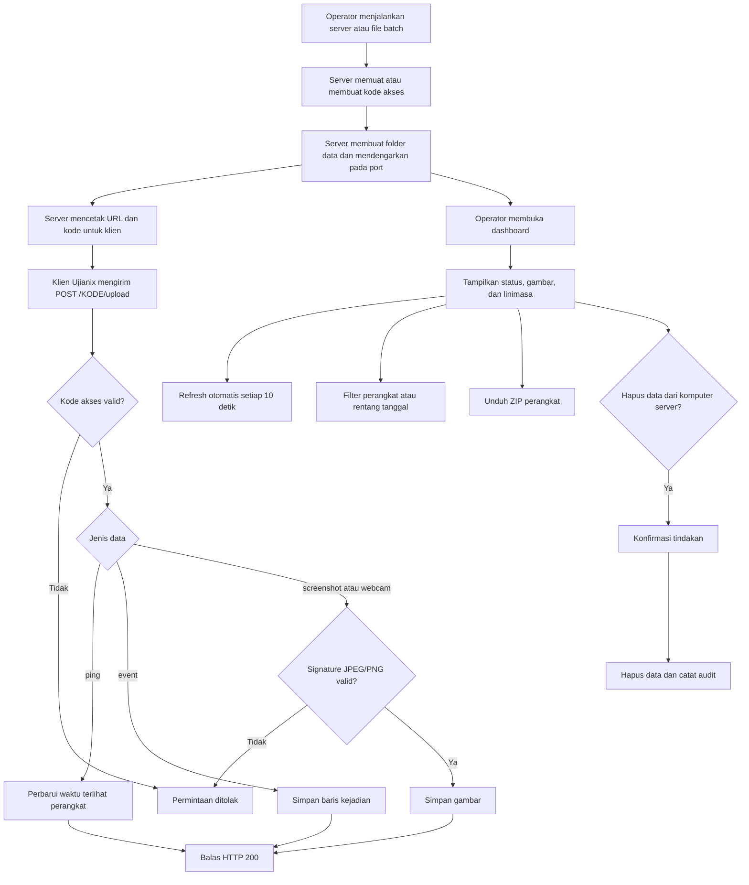

# Dokumentasi Server Pengawasan Peserta Ujianix

Dokumen ini menjelaskan implementasi yang tersedia di [ujianix-pengawas.py](./ujianix-pengawas.py) dan cara menjalankannya menggunakan [jalankan-pengawas.bat](./jalankan-pengawas.bat). Skrip Python tersebut adalah server penerima data sekaligus dashboard lokal; pengambilan screenshot, webcam, dan pengiriman data dari perangkat peserta dilakukan oleh klien Ujianix, bukan oleh skrip server ini.

## 1. Ringkasan

Server menyediakan:

- Endpoint HTTP untuk menerima ping, kejadian, screenshot, dan foto webcam.
- Dashboard berbahasa Indonesia untuk melihat status, jumlah perangkat aktif, gambar, dan linimasa.
- Filter dashboard berdasarkan perangkat dan rentang tanggal, dengan pembaruan otomatis.
- Unduhan semua berkas milik satu perangkat sebagai ZIP.
- Penghapusan gambar, kategori data, perangkat, atau seluruh data melalui dashboard lokal.
- Pencatatan tindakan penghapusan ke `data-pengawasan/audit.log`.

Server menangani permintaan secara konkuren menggunakan `ThreadingHTTPServer`. Skrip hanya menggunakan pustaka standar Python. Tidak ada basis data: data disimpan sebagai folder dan berkas di disk.

## 2. Persyaratan dan cara menjalankan

- Python 3.
- Perintah `py` tersedia jika menjalankan server dengan file batch.
- Jaringan yang memungkinkan perangkat peserta menjangkau komputer server.
- Izinkan Python menerima koneksi masuk melalui firewall bila diperlukan.

Jalankan dari folder tempat skrip berada:

```powershell
py ujianix-pengawas.py
```

Tanpa argumen, port bawaan adalah `8000`. Port dapat ditentukan sebagai argumen pertama:

```powershell
py ujianix-pengawas.py 8000
```

### Menjalankan dengan file batch

Di Windows, jalankan [jalankan-pengawas.bat](./jalankan-pengawas.bat) dengan klik ganda atau dari Command Prompt. File batch berpindah ke folder tempat file itu berada, menjalankan `py ujianix-pengawas.py 8000`, lalu menampilkan `pause` setelah proses Python berhenti agar pesan terakhir tetap dapat dibaca. File ini selalu menggunakan port 8000; untuk port lain, jalankan perintah Python secara langsung.

Jangan jalankan lebih dari satu server pada port yang sama. Jika port 8000 sedang dipakai, server kedua tidak dapat mulai sampai port tersebut tersedia.

### Informasi saat server mulai

Saat mulai, server membuat folder `data-pengawasan`, menampilkan URL dashboard lokal, alamat IPv4 non-loopback yang terdeteksi, dan kode akses. Jika komputer memiliki beberapa alamat jaringan, pilih alamat yang dapat dijangkau klien. Jika tidak ada alamat yang tercetak, periksa konfigurasi jaringan komputer server.

URL untuk klien berbentuk:

```text
http://ALAMAT-IP-SERVER:PORT/KODE
```

Gunakan salah satu alamat IP yang dicetak server. Kode di akhir URL dibuat otomatis dengan generator acak dan disimpan di `pengawas-kode.txt`; jika file tersebut sudah berisi kode dengan format yang valid, kode itu digunakan kembali. Jika file tidak ada atau nilainya tidak valid, server membuat kode baru. Jangan membagikan URL atau file kode kepada pihak yang tidak berwenang.

Server mendengarkan pada semua antarmuka jaringan (`0.0.0.0`). Izinkan aplikasi Python di Windows Firewall bila diminta. Hentikan proses dengan `Ctrl+C`; saat memakai file batch, tekan tombol saat prompt `pause` untuk menutup jendela.

## 3. Alur kerja



1. Operator menjalankan skrip pada komputer pengawas.
2. Perangkat Ujianix dikonfigurasi dengan URL server yang memuat alamat IP, port, dan kode.
3. Klien mengirim HTTP `POST` ke endpoint `/KODE/upload` dengan header jenis data dan ID perangkat.
4. Server menyimpan data ke folder perangkat di `data-pengawasan`.
5. Dashboard membaca berkas dari folder tersebut dan memperbarui tampilan setiap 10 detik.
6. Operator dapat memfilter dan melihat status, gambar, linimasa, mengunduh ZIP, atau menghapus data dari komputer server.

Skrip server tidak menampilkan dialog privasi peserta, memulai/menghentikan ujian, mengambil gambar, atau mengontrol kamera. Perilaku tersebut berada di luar implementasi file ini.

## 4. Protokol upload

Semua upload menggunakan `POST /KODE/upload`. Body adalah data mentah, bukan JSON. Header yang digunakan:

| Header | Fungsi |
|---|---|
| `X-Ujianix-Device` | ID perangkat; karakter selain huruf, angka, titik, garis bawah, dan tanda hubung diganti `_`, lalu dibatasi hingga 80 karakter. Jika kosong, server menggunakan `perangkat`. |
| `X-Ujianix-Kind` | Jenis data: `ping`, `event`, `screenshot`, atau `webcam`. |
| `Content-Length` | Ukuran body. Harus lebih dari 0 dan maksimal 8 MiB. |

Klien harus mengirim URL dengan kode akses dan menyertakan `Content-Length` yang sesuai dengan jumlah byte body. Batas 8 MiB berlaku untuk setiap permintaan, bukan untuk total data yang disimpan.

Perilaku berdasarkan jenis:

| Jenis | Isi body | Hasil |
|---|---|---|
| `ping` | Body apa pun yang memenuhi batas ukuran | Memperbarui waktu terlihat perangkat; tidak menyimpan isi body. |
| `event` | Teks UTF-8 (byte yang tidak valid diganti karakter pengganti) | Menambahkan satu baris bertanggal `YYYY-MM-DD HH:MM:SS` ke `events.log`. Teks dibatasi 300 karakter dan baris baru diganti spasi. |
| `screenshot` | Gambar JPEG atau PNG | Menyimpan gambar dengan nama bertimestamp dan jenis `screenshot`. |
| `webcam` | Gambar JPEG atau PNG | Menyimpan gambar dengan nama bertimestamp dan jenis `webcam`. |

Untuk gambar, format ditentukan dari signature JPEG atau PNG; format lain ditolak. Nama berkas menggunakan waktu lokal server dengan pola `YYYYMMDD-HHMMSS-jenis.ext`. Jika ada nama yang sama pada detik yang sama, server menambahkan akhiran angka agar berkas yang sudah ada tidak tertimpa. ID perangkat dibersihkan sebelum digunakan sebagai nama folder; karakter yang tidak diizinkan diganti garis bawah.

Upload yang berhasil membalas HTTP `200` dengan body `ok`. Ukuran yang tidak diizinkan membalas `413`; panjang body tidak valid, jenis tidak dikenal, atau format gambar tidak didukung membalas `400`. Kode akses yang tidak valid ditolak dengan HTTP `403`; path endpoint yang tidak dikenal membalas `404`.

Upload yang berhasil selain ping dicetak ke konsol server dengan waktu, ID perangkat, jenis, dan ukuran byte. Ping tidak dicetak. Log akses HTTP standar dinonaktifkan; tindakan penghapusan tetap dicetak dan disimpan di audit log.

## 5. Dashboard dan endpoint baca

Dashboard berbahasa Indonesia menampilkan satu kartu untuk setiap folder perangkat, dengan:

- Status **Aktif** atau **Terputus**, waktu terakhir terlihat, dan ringkasan jumlah screenshot serta foto webcam.
- Jumlah perangkat aktif dari perangkat yang sedang ditampilkan.
- Gambar terbaru berukuran besar dan hingga 14 thumbnail untuk setiap jenis gambar. Gambar dapat dibuka dalam tab baru.
- Linimasa menurun berdasarkan waktu yang memuat screenshot, foto webcam, kejadian yang dapat dibaca, dan status koneksi.
- Filter berdasarkan satu perangkat, tanggal awal, tanggal akhir, atau kombinasi keduanya. Tombol reset menghapus filter.
- Tautan ZIP pada setiap kartu perangkat.
- Tombol penghapusan lokal jika dashboard dibuka dari komputer server.
- Tampilan responsif untuk layar kecil; pada perangkat sentuh, tombol hapus gambar di thumbnail selalu terlihat.

Dashboard memuat ulang bagian kontennya setiap 10 detik tanpa cache. Filter tanggal berlaku pada gambar, jumlah gambar, dan catatan linimasa; status aktif dihitung terpisah dari filter tanggal. Jika belum ada perangkat, dashboard menampilkan pesan menunggu data. Bagian tanpa gambar menampilkan pesan bahwa kiriman belum tersedia. Jika permintaan refresh gagal, tampilan yang ada dipertahankan dan tidak ada notifikasi; refresh berikutnya tetap dijadwalkan.

Status dianggap aktif jika perangkat terlihat dalam 90 detik terakhir. Waktu terlihat diperoleh dari ping/upload yang diterima selama proses berjalan dan waktu modifikasi berkas. Karena ping membuat folder perangkat, perangkat dapat muncul di dashboard meskipun belum mengirim gambar. Data waktu ping berada di memori proses; setelah restart, status dihitung dari waktu modifikasi berkas yang tersisa.

Waktu gambar dibaca dari nama berkas, dengan waktu modifikasi sebagai fallback. Linimasa kejadian dapat membaca baris bertanggal `YYYY-MM-DD HH:MM:SS` dan format lama `DD/MM HH:MM:SS` (tahun diambil dari waktu modifikasi `events.log`). Baris kejadian yang tidak dapat diparse tidak ditampilkan dalam linimasa.

Tanggal filter memakai format ISO `YYYY-MM-DD`; tanggal awal dan akhir bersifat inklusif. Tanggal tidak valid, ID perangkat yang tidak valid, atau tanggal awal yang melewati tanggal akhir ditolak dengan HTTP `400`.

Di komputer server, dashboard dapat dibuka tanpa kode melalui `http://127.0.0.1:PORT/` atau `http://localhost:PORT/`. Permintaan dari perangkat lain harus menyertakan kode pada path; tanpa kode, akses ditolak. Endpoint baca yang tersedia:

| Path | Fungsi |
|---|---|
| `/KODE/` | Dashboard jarak jauh. Di komputer server, path lokal `/` juga dapat digunakan. |
| `/KODE/img/ID-PERANGKAT/NAMA-BERKAS` | Membaca gambar JPEG/PNG yang tersimpan. |
| `/KODE/zip/ID-PERANGKAT` | Mengunduh berkas langsung dalam folder perangkat sebagai ZIP. |
| `/KODE/upload` (`POST`) | Menerima data klien, sebagaimana dijelaskan pada bagian protokol upload. |
| `/[KODE]/delete` (`POST`) | Endpoint penghapusan yang dipakai dashboard lokal; bagian `KODE` ada jika dashboard dibuka dengan URL berkode. Bukan endpoint yang tersedia bagi perangkat jarak jauh. |

Gambar dan ZIP dapat dibaca oleh klien jarak jauh yang mengetahui kode. ZIP dibuat saat diminta, tidak dikompresi, dan mencakup berkas reguler yang berada langsung di folder perangkat, misalnya gambar dan `events.log`; audit log berada di luar folder perangkat dan tidak disertakan. Respons dilayani tanpa cache.

## 6. Penghapusan data

Tombol penghapusan hanya ditampilkan saat dashboard dibuka secara lokal di komputer server melalui `http://127.0.0.1:PORT` atau `http://localhost:PORT`. Server mensyaratkan koneksi loopback serta nilai `Host` lokal dengan port yang benar, header `X-Ujianix-Hapus: 1`, dan `Origin` yang cocok bila header tersebut dikirim. Permintaan yang tidak memenuhi pemeriksaan ditolak.

Tindakan dashboard yang tersedia:

- Menghapus satu gambar melalui tombol pada thumbnail.
- Menghapus semua screenshot satu perangkat.
- Menghapus semua foto webcam satu perangkat.
- Menghapus catatan kejadian satu perangkat.
- Menghapus seluruh data satu perangkat.
- Menghapus seluruh data perangkat.

Setiap tindakan menampilkan dialog konfirmasi dan menyediakan tombol batal. Untuk menghapus semua data, operator juga harus mengetik `HAPUS`; jika tidak cocok, tindakan tidak dilanjutkan. Setelah berhasil, dashboard menampilkan notifikasi dan memperbarui konten. Jika gagal, dashboard menampilkan pesan kesalahan. Penghapusan bersifat permanen.

Setiap permintaan penghapusan yang berhasil dicatat ke `data-pengawasan/audit.log` dengan waktu, tindakan, target, jumlah berkas atau baris kejadian yang dihapus, dan alamat sumber. Jumlah untuk penghapusan kejadian menghitung baris log, sedangkan tindakan lain menghitung berkas. Menghapus semua data menghapus isi folder perangkat dan status aktif dalam memori; file audit log dan `pengawas-kode.txt` tidak dihapus.

Dashboard mengirim permintaan penghapusan sebagai JSON dengan properti `action`, `device`, dan `file` serta header `X-Ujianix-Hapus: 1`. Tindakan yang diterima server adalah `image`, `screenshots`, `webcams`, `events`, `device`, dan `all`. Body permintaan dibatasi maksimal 4 KiB. Jika diakses bukan dari loopback, header penghapusan tidak ada, atau `Origin` tidak cocok, server membalas `403`; data atau aksi yang tidak valid membalas `400`.

## 7. Struktur penyimpanan

Semua path data relatif terhadap folder skrip:

```text
pengawas-kode.txt
data-pengawasan/
  audit.log
  ID-PERANGKAT/
    YYYYMMDD-HHMMSS-screenshot.jpg
    YYYYMMDD-HHMMSS-webcam.png
    events.log
```

`events.log` dibuat ketika kejadian diterima. Berkas gambar hanya dibuat untuk upload screenshot atau webcam. Tidak ada kebijakan retensi atau pembersihan otomatis; data tetap ada sampai dihapus secara manual atau dihapus oleh pengelola sistem.

## 8. Keamanan dan batasan

- Komunikasi menggunakan HTTP biasa; skrip ini tidak menyediakan TLS.
- Kode pada path URL adalah kunci akses bersama (bearer secret), bukan sistem autentikasi pengguna. Siapa pun yang mengetahui URL dapat mengakses dashboard jarak jauh, gambar, dan ZIP serta mengirim upload dengan kode tersebut. Karena URL dikirim melalui HTTP, kode dan data juga tidak terlindungi dari penyadapan pada jaringan.
- Kode disimpan dalam teks biasa pada `pengawas-kode.txt`. Lindungi akses ke komputer dan folder server, serta jangan memasukkan file atau URL berkode ke repositori publik, log, atau dokumentasi yang dibagikan.
- Dashboard dan endpoint baca tidak memiliki akun atau pembagian hak akses operator.
- Penghapusan dibatasi ke komputer server, tetapi pembatasan ini bukan pengganti autentikasi dan keamanan host.
- Server mendengarkan pada semua antarmuka jaringan. Jalankan hanya pada jaringan yang dipercaya; jangan mengekspos prototipe ini langsung ke Internet.
- Batas 8 MiB berlaku untuk setiap body upload, bukan untuk total penyimpanan.
- Skrip tidak menerapkan retensi otomatis, enkripsi data tersimpan, atau perlindungan TLS.

Untuk penggunaan operasional, pengelola harus menyediakan perlindungan jaringan dan host yang sesuai, membatasi siapa yang dapat membaca kode akses dan data, serta menetapkan prosedur retensi dan penghapusan.

## 9. Cakupan dokumen

Dokumentasi ini merujuk pada perilaku di `ujianix-pengawas.py`. Detail sisi klien Ujianix—termasuk kapan screenshot/webcam diambil, persetujuan peserta, jadwal pengiriman, dan format tepat yang dikirim—harus didokumentasikan dari kode klien yang bersangkutan; hal tersebut tidak dapat dipastikan dari skrip server ini saja.
